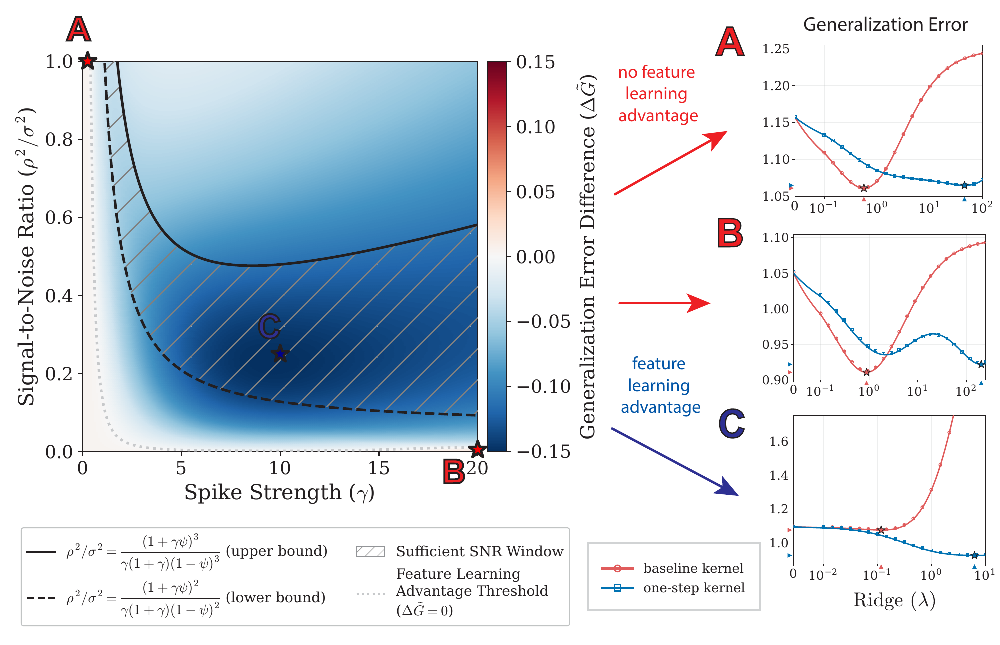

# Investigating the Early Signatures of Feature Learning in Deep Linear Networks

**Shaunak Bhandarkar and Boris Hanin** (Princeton University)

📄 **Paper:** [arXiv:2610.37834](https://arxiv.org/abs/2610.37834)

This repository contains the code for our paper, which asks: *what data-dependent features does a deep neural network learn, and when do such features generalize better than fixed, data-independent ones?*

## Summary

We give a closed-form account of feature learning for a deep linear network in a mean-field parameterization, trained by **one gradient step** from initialization on high-dimensional data carrying a low-dimensional (spiked) signal. Inputs are sampled as $x_i \sim N(0, I_D + \gamma vv^\top)$ and targets as $y_i = \frac{1}{\sqrt{D}} w_\star^\top x_i + \epsilon_i$. Two parameters govern the task: the **spike strength** $\gamma$ and the **spike-target alignment** $\rho = \frac{1}{\sqrt{D}} w_\star^\top v$.

In short, one step updates each layer's feature kernel by a rank-one spike. That spike sets the kernel up to meaningfully learn the spike in the data when the spike strength and SNR are sufficiently large, and the kernel fails to do so when this structure is missing.

## Figure 1

<p align="center">
  
</p>

The heatmap shows the minimal asymptotic generalization error (over ridge strengths $\lambda \geq 0$) of kernel ridge regression on the **learned one-step features**, relative to the **baseline features at initialization**. Blue denotes a feature learning advantage, and red denotes the opposite. The hatched region is an "SNR window" in which a global feature learning advantage provably holds: certain one-step ridge estimators can outperform *any* baseline ridge estimator.

The panels on the right show generalization error over $\lambda$ for both estimators. The one-step estimator loses when the spike is weak (**A**) or when the SNR is small (**B**), and wins when both are sufficiently large (**C**). Dots are simulations; lines are theory.

## Main takeaways

1. **One step imprints a target-aligned rank-one spike on every feature kernel, amplified by learning rate and depth.** As width $N \to \infty$, the layer-$\ell$ feature kernel moves from the input kernel $K_x = X^\top X / D$ to

   $$K_x + \frac{\eta^2 d_\ell}{n^2} K_x yy^\top K_x, \qquad d_\ell = \frac{\ell(\ell+1)(2\ell+1)}{6}.$$

   For a fixed step size, feature evolution after one step is more dramatic in deeper layers.

2. **One step of feature learning inflates estimation.** Kernel ridge regression on the learned kernel gives $c_\lambda \hat f_{\lambda;0}(x)$: a uniform scalar inflation ($c_\lambda \geq 1$) of the baseline estimator. This "anti-shrinkage" mechanism re-inflates task-relevant directions suppressed by ridge, while also amplifying noise.

3. **Ridge and feature learning act as opposing forces along the bias-variance axis.** Ridge shrinks the estimator, which increases bias and decreases variance. Feature learning-induced inflation corrects shrinkage on average, which decreases bias at the cost of increased variance.

4. **A feature learning advantage requires low-dimensional task structure.** One step helps when both the spike strength and an effective SNR ($\rho^2/\sigma^2$) are sufficiently large. For isotropic inputs ($\gamma = 0$) or a task-orthogonal spike ($\rho = 0$), no one-step estimator beats the optimally tuned baseline. A successful first gradient step both *requires* and *benefits from* this structure.

## Repository structure

| File | Purpose |
| --- | --- |
| `stieltjes_asymptotics.py` | Closed-form asymptotics: bias, variance, generalization error, and the SNR phase diagram (Fig. 1) |
| `kernel_ridge_regression.py` | Data generation and empirical KRR estimators |
| `finite_width_experiments.py` | Finite-width validation of the one-step feature kernel update |
| `c_lambda_experiments.py` | The inflation constant $c_\lambda$ |
| `run_sweep.py` | Generalization error sweeps over $(\gamma, \rho)$ (SLURM-array friendly) |
| `bias_variance_experiments.py` | Bias and variance curves |
| `make_figures.py` | Paper figures, made from the saved sweep data |
| `unit_tests.py` | Checks of empirics against theory |

To reproduce the figures:

```bash
pip install -r requirements.txt
python run_sweep.py --all          # likewise for the other *_experiments.py drivers
python make_figures.py
```

Sweep outputs (`.pkl`) are not tracked, so they need to be regenerated before plotting.

## How to cite

If you find this work useful, please cite:

```bibtex
@article{bhandarkar2026early,
  title   = {Investigating the Early Signatures of Feature Learning in Deep Linear Networks},
  author  = {Bhandarkar, Shaunak and Hanin, Boris},
  journal = {arXiv preprint arXiv:2610.37834},
  year    = {2026}
}
```

**Corresponding author:** Shaunak Bhandarkar ([shaunak@princeton.edu](mailto:shaunak@princeton.edu))
